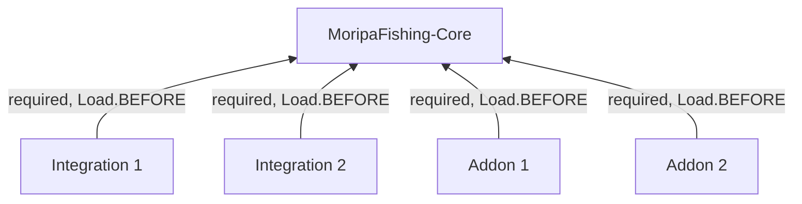

MoripaFishing は **Integration** と **Addon** の 2 種類の外部プラグインと連携します。
どちらも Core に依存するプラグインですが、役割が異なります。

| 区分 | 依存関係 | 代表例 | 特徴 |
|---|---|---|---|
| **Core** | — | `MoripaFishing` 本体 | 魚抽選・釣りイベント・天候や時刻の決定などの最小機能。Bukkit ワールドの天候・時刻・ゲームルール・スポーン・ボーダーは変更しない |
| **Integration** | Integration が Core に必須依存 | `MoripaFishing-Integration-WorldLifecycle` | Core が決めた値を Bukkit ワールドへ適用する SPI 実装を `ServicesManager` に登録する |
| **Addon** | Addon が Core をソフト依存 | `MoripaFishing-Addon-CatchAnnounce` | Core の公開 API とイベントを利用して拡張する外部プラグイン |



Addon も Core に必須依存し (`server("MoripaFishing", Load.BEFORE, required = true)`)、Core の後にロードされます。

## 役割の分担

Core は **決定** だけを行い、Integration は **適用** だけを行います。

- Core は天候 (魚の抽選条件に使う値と、ワールドへ適用させる値)・時刻・ゲームルールの値・ボーダー・スポーンを決めます。
- Integration は Core から受け取った値をそのまま Bukkit ワールドへ書き込み、ワールドの作成・アンロードを実行します。
- Core 自身は Bukkit ワールドへ一切書き込みません。Integration がなくても、Core は値を決めて魚の抽選に使います。

## Integration の作り方

### 依存の宣言

Integration は Core に必須依存し、Core の後にロードされます。

```kotlin title="build.gradle.kts"
dependencies {
    // SPI を含む Core の公開 API。実行時は Core 本体のクラスを使うため、jar に同梱 (shade) しない
    compileOnly("party.morino:moripafishing-api:<version>")
    compileOnly("io.papermc.paper:paper-api:<version>")
}

paperPluginYaml {
    dependencies {
        // Core の後にロードし、join-classpath (既定で有効) で Core のクラスを参照する
        server("MoripaFishing", PaperPluginYaml.Load.BEFORE, required = true)
    }
}
```

`:api` (`moripafishing-api`) を Integration の jar に同梱してはいけません。
同梱すると SPI のインターフェースが Core と別のクラスローダーで読み込まれ、Core から別の型として扱われるためです。

### サービスの登録

SPI の実装は Bukkit の `ServicesManager` に登録します。
登録はプラグインの無効化時に Bukkit が自動で解除するため、解除処理を書く必要はありません。

```kotlin
override fun onEnable() {
    server.servicesManager.register(WorldStateApplier::class.java, MyApplier(), this, ServicePriority.Normal)
}
```

Core はサービスを使うたびに `ServicesManager` から引き直します。後から登録・解除されたサービスも、次のリフレッシュから反映されます。

### SPI 一覧

SPI はすべて `party.morino.moripafishing.api.core.world.spi` パッケージにあります。

| インターフェース | 使われ方 | 役割 |
|---|---|---|
| `WorldStateApplier` | 登録された **全件** が呼ばれる | Core が決めた `WorldState` を Bukkit ワールドへ適用する。各実装は担当する項目だけを見る |
| `WorldLifecycle` | **最優先の 1 件** だけが使われる | Bukkit ワールドの作成 (`createWorld`)・アンロード (`unloadWorld`)・ジェネレーター ID の列挙 |
| `WeatherSource` | `key` が一致する **最優先の 1 件** | 天候の方針 `external` から参照される外部天候ソース。詳細は [API ガイド](/addons/api-guide#weathersource-の登録) |

### `WorldState` の契約

`WorldState` は、ある釣りワールドのあるべき状態です。

| フィールド | 意味 |
|---|---|
| `worldId` / `worldKey` | 釣りワールドの ID と、対応する Bukkit ワールドのキー |
| `weather` | 適用する天候。`null` は「天候を変更しない」 |
| `doWeatherCycle` | ゲームルール `ADVANCE_WEATHER` の値 (`weather == null` のとき `true`) |
| `time` | 適用するワールド時刻 (`0..23999`)。`null` は「時刻を変更しない」 |
| `doDaylightCycle` | ゲームルール `ADVANCE_TIME` の値 (`time == null` のとき `true`) |
| `border` | 適用するワールドボーダー。`null` は「ボーダーを変更しない」 |
| `spawn` | 適用するスポーン地点 |

- Core は定期リフレッシュ・ワールドのロード時・設定の変更時に、毎回 **全項目** を送ります。差分ではありません。
- 適用は **冪等** にしてください。同じ状態が何度届いても結果が変わらないようにします。
- `null` の項目には触れないでください。ただし `weather == null` のときは、その Integration が以前に駆動していた演出 (例: CLOUDY の天井) だけを解除して構いません。
- ゲームルールの値は Core が決めます。Integration は受け取った値をそのまま書き込みます。
- 対象の Bukkit ワールドが未ロードのときは何もしません。

### スレッド

- `WorldStateApplier.apply`・`WorldLifecycle.createWorld`・`WorldLifecycle.unloadWorld` は **メインスレッド** から呼ばれます。
- `WorldLifecycle.getGeneratorIds` (コマンドの補完などから呼ばれる) と `WeatherSource.getWeather` は **任意のスレッド** から呼ばれます。スレッドセーフに実装し、Bukkit API を直接呼ばないでください。

### 例外

SPI 実装が投げた例外は Core が受け止め、登録元プラグイン名付きで警告したうえで失敗として扱います。

- `WorldStateApplier.apply`: その実装の適用だけが失敗し、他の実装への適用は続きます。
- `WorldLifecycle`: `getGeneratorIds` は空、`createWorld` / `unloadWorld` は `false` として扱います。
- `WeatherSource.getWeather`: 内蔵の天候カレンダー (`random` の既定値) で代わりに決めます。警告は成功するまで一度だけ出ます。

### 型の制約

Integration が Kotlin 標準ライブラリを同梱していても安全に呼べるよう、SPI のシグネチャには
`:api` の型・`Key`・`String`・Java のプリミティブとそのボックス型・`java.util` のコレクションだけを使っています。
Kotlin の関数型・`Pair`・`Result`・value class・inline 関数は使いません。

Integration 側でも、`:api` のクラスのコンストラクタを既定引数を省略して呼ばないでください。
既定引数付きコンストラクタの合成オーバーロードは `kotlin.jvm.internal.DefaultConstructorMarker` を引数に取るため、
Integration が同梱した標準ライブラリのクラスとして解決されるとリンクに失敗します。
データクラスの `copy(...)` や既定引数付きの関数は、合成メソッドの引数が `Object` なので影響を受けず、呼んで構いません。

## 起動の順序

1. Core が有効化され、`world/` の設定ファイルから釣りワールドを定義します。この時点ではワールドに触れません。
2. Integration が有効化され、サービスを登録します。
3. 全プラグインの有効化後に発火する `ServerLoadEvent` で、Core が釣りワールドの運用を始めます。
   - ロード済みの釣りワールドへ状態を適用し、`FishingWorldLoadEvent` を発火します。
   - 未ロードの釣りワールドは `WorldLifecycle` で作成します。作成時の `WorldLoadEvent` を受けて状態を適用します。
   - 以降は `refreshIntervalSeconds` ごとにメインスレッドで状態を適用し直します。

プラグインの無効化時、Core はワールドに触れません。Integration は自分が駆動していた演出を `onDisable` で片付けます。

## Integration 未導入時の挙動

Integration が無くても Core は起動し、欠けている機能だけが縮退します。

- **`WorldStateApplier` が無い**: 状態は決まりますが、どのワールドにも適用されません。天候は魚の抽選条件として使われ続けます。
- **`WorldLifecycle` が無い**: 未ロードの釣りワールドは作成されず、警告ログが出ます。
  `WorldManager.createWorld` は `false` を返し、`WorldManager.getGeneratorIds` は空を返します。
  ロード済みのワールドの `deleteWorld` も `false` を返します。未ロードのワールドの定義は Integration なしで削除できます。
- **`WeatherSource` が無い**: 天候の方針 `external` は内蔵の天候カレンダー (`random` の既定値) で代わりに決まり、警告が一度だけ出ます。

Core は Bukkit ワールドへ一切書き込まないため、Core だけを導入しても既存ワールドの天候・時刻・ゲームルールが上書きされることはありません。

## 提供される Integration

現時点で公式に提供されている Integration は以下です。

- [`MoripaFishing-Integration-WorldLifecycle`](/integration/world-lifecycle): 時刻・`ADVANCE_TIME`・ワールドボーダー・スポーン地点の適用と、ジェネレーターを使ったワールドの作成・アンロード
- [`MoripaFishing-Integration-Weather`](/integration/weather): 天候と `ADVANCE_WEATHER` の適用 (嵐の切り替えと CLOUDY のクライアント側バリア天井)

## 提供される Addon

公式に提供されている Addon は以下です。

- [`MoripaFishing-Addon-CatchAnnounce`](/addons/catch-announce): 釣果のアナウンス

## 命名規則

プラグイン名からも種別が一目でわかるよう、外部プラグインの名前には共通の接頭辞を付けています。
Integration は `MoripaFishing-Integration-<名前>`、Addon は `MoripaFishing-Addon-<名前>` という形式で命名されます。
`plugins/` フォルダや依存プラグイン一覧に並んだときも、この接頭辞を見れば Core の値をワールドへ適用する Integration なのか、
Core の API とイベントを使って機能を足す Addon なのかをすぐに判別できます。
